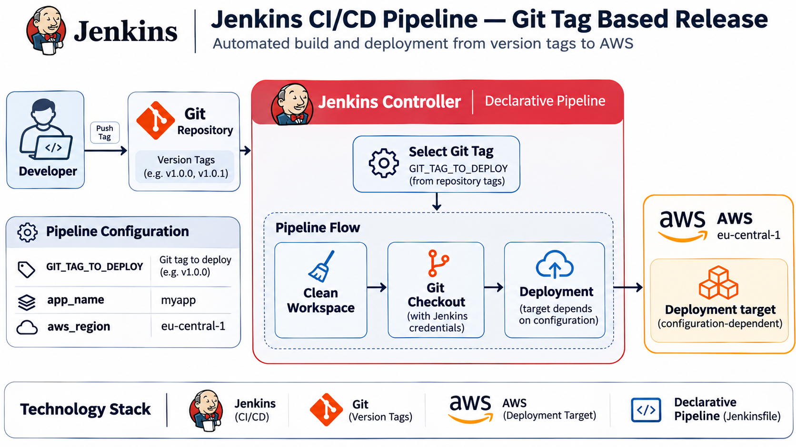

# cicd-pipeline

## Architecture



# Jenkins CI/CD Pipeline

A Jenkins-based CI/CD automation project demonstrating version-controlled application delivery, Git tag-based releases, and AWS deployment workflows using Declarative Pipelines.

## Overview

This project focuses on automating application delivery with Jenkins. The pipeline uses a Git repository as its source, allows users to select application versions through Git tags, and organizes deployment operations into repeatable stages.

The goal is to reduce manual release operations, improve deployment consistency, and provide visibility into pipeline execution.

## Technology Stack

- **Jenkins** — CI/CD automation
- **Groovy** — Declarative Pipeline configuration
- **Git** — Source code management
- **AWS** — Cloud deployment environment
- **Git Parameter Plugin** — Git tag selection
- **Jenkins Credentials** — Secure repository authentication

## Architecture


## Key Features

- Declarative Jenkins pipeline
- Parameterized application releases
- Git tag-based version selection
- Automated source code checkout
- Git authentication using Jenkins credentials
- Workspace cleanup before checkout
- Timestamped pipeline execution logs
- AWS region configuration
- Repeatable release workflow

## Pipeline Workflow

```text
          Developer
              |
              v
        Git Repository
              |
              v
       Jenkins Pipeline
              |
              v
       Select Git Tag
              |
              v
       Clean Workspace
              |
              v
      Checkout Source Code
              |
              v
       Deployment Stages
              |
              v
        AWS Environment
         eu-central-1
```

## Pipeline Configuration

The Jenkinsfile defines the following parameters and environment variables:

| Parameter | Description |
|---|---|
| `GIT_TAG_TO_DEPLOY` | Selected application version |
| `aws_region` | AWS region (`eu-central-1`) |
| `app_name` | Application identifier (`myapp`) |

The Git Parameter Plugin enables selection of version tags matching the configured tag filter.

## Getting Started

### 1. Clone the Repository

```bash
git clone https://github.com/Msrt12/jenkins_ci_cd.git
cd jenkins_ci_cd
```

### 2. Configure Jenkins

Ensure Jenkins has the required plugins:

- Pipeline
- Git
- Git Parameter
- Credentials Binding
- Workspace Cleanup
- Timestamper

Configure Git repository credentials in Jenkins using the credential ID referenced by the pipeline.

### 3. Create a Pipeline Job

1. Open Jenkins Dashboard.
2. Select **New Item**.
3. Create a **Pipeline** job.
4. Select **Pipeline script from SCM**.
5. Choose Git as the SCM.
6. Enter the repository URL.
7. Select the `main` branch.
8. Set the script path to the Jenkinsfile location.
9. Save the configuration.

### 4. Run the Pipeline

Select **Build with Parameters**.

Choose the required Git tag using:

```text
GIT_TAG_TO_DEPLOY
```

Start the pipeline and monitor execution through Jenkins Console Output.

## Git Tag-Based Releases

The pipeline supports selecting specific application versions instead of always deploying the latest commit.

Example Git commands:

```bash
git tag 1.0.0
git push origin 1.0.0
```

The selected tag determines the source revision checked out by Jenkins.

This supports reproducible release selection and makes previous application versions available for subsequent deployment runs.

## Monitoring and Troubleshooting

Jenkins provides execution history, stage status, and console logs.

Common troubleshooting areas include:

- Invalid Git credentials
- Missing repository tags
- Incorrect Jenkins plugin configuration
- Failed source checkout
- Missing deployment permissions
- AWS authentication or configuration issues

## Skills Demonstrated

- CI/CD Pipeline Development
- Jenkins Declarative Pipelines
- Groovy Automation
- Git Version Control
- Release Management
- Jenkins Credential Management
- AWS Deployment Configuration
- Pipeline Troubleshooting

## Author

**Mykola Dmytrash**

- [GitHub](https://github.com/Msrt12)
- [Portfolio](https://msrt12.github.io/portfolio/)
